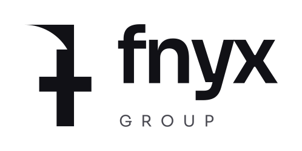

  <picture>
    <source media="(prefers-color-scheme: dark)" srcset="assets/fnyx-group_logo_blanc.svg">
    <source media="(prefers-color-scheme: light)" srcset="assets/fnyx-group_logo_noir.svg">
    
  </picture>

fnyx-group builds free, open-source, privacy-first apps to help people. No ads, no tracking, no data collection.

## Principles

- Local-first and encrypted
- No ads or trackers
- Open source and auditable
- Non-profit

## Projects

- [flust](https://github.com/fnyx-group/flust): a mobile app to quit pornography and track recovery. In development.

## Contact

- Email: contact@fnyx-group.org
- Security issues: see the `SECURITY.md` file in each repository.
- Website: https://fnyx-group.org
