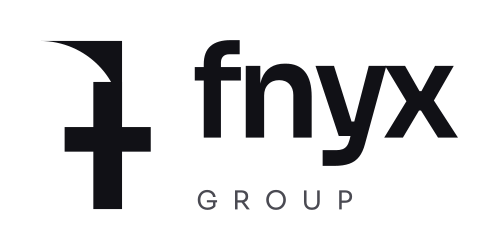

  <picture>
    <source media="(prefers-color-scheme: dark)" srcset="assets/fnyx-group_logo_blanc.svg">
    <source media="(prefers-color-scheme: light)" srcset="assets/fnyx-group_logo_noir.svg">
    
  </picture>

fnyx-group makes free apps to help people. The code is open source, and your data stays on your phone, encrypted. There is no account, no advertising and no tracking.

## Projects

[flust](https://github.com/fnyx-group/flust) is an app to help people quit pornography, including pornography made with AI. It is in development.

[fnoise](https://fnyx-group.org/fnoise/) is an app to quiet the noise in your head and on your phone. It is being planned.

## Contact

Write to contact@fnyx-group.org, in English or French. To report a security issue, follow the SECURITY.md file of the repository concerned.

More on [fnyx-group.org](https://fnyx-group.org).
